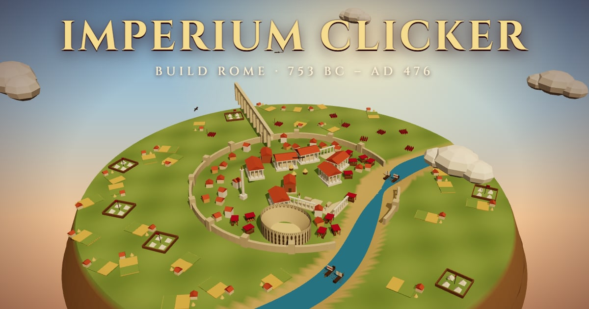

# Imperium Clicker

[](https://timurcravtov.github.io/RomanEmpireClicker/)

**[▶ Play in your browser](https://timurcravtov.github.io/RomanEmpireClicker/)**

A Roman Empire idle/clicker game built with React, Vite and Three.js.

Strike gold denarii, raise a living 3D Rome from Romulus's huts to the Colosseum,
and steer twelve centuries of real history, from the founding of the city in 753 BC
to the fall of the West in AD 476.

## Run

```bash
npm install
npm run dev      # start the dev server
npm run build    # production build
npm test         # engine unit tests (vitest)
```

## Deploy

Pushing to `main` runs tests, builds, and publishes to GitHub Pages
(`.github/workflows/deploy.yml`). One-time setup: in the repo go to
**Settings → Pages → Build and deployment → Source: GitHub Actions**.

## Features

**A living 3D Rome**
- The city fills the screen and grows with every purchase: farms, insulae, markets,
  aqueduct arches, temples, the Forum and the Senate rise out of the ground
- Legions drill on the Campus Martius, triremes row along the Tiber, eagles circle overhead
- History shapes the skyline: the Servian Wall after the Gallic sack, the Colosseum, Trajan's Column
- A spinning gold denarius to click, bursting coins with every strike
- Drag to orbit, scroll to zoom; falls back gracefully without WebGL

**The Chronicle**
- 16 chapters of Roman history unlock as your reign grows, each with a boon for that reign
- Historical decisions: pay Brennus or fight with iron, Fabius or Scipio against Hannibal,
  cross the Rubicon or obey the Senate, debase the coinage or reform with Diocletian;
  after you choose, the card shows what history actually records
- Omens of Fortuna: catch a drifting laurel for a Triumph, Bread and Circuses, Saturnalia or favorable auspices
- The Acta Diurna ticker with era-aware headlines and real Pompeii graffiti

**The economy**
- 11 buildings with exponential costs and ×1 / ×10 / ×100 / Max buying
- Edicts: click multipliers, three tiers per building, and global bonuses
- 20 achievements and 8 ranks, from Plebeian to Imperator Augustus
- Prestige ("Ascend"): trade a reign for Glory (+5% production and clicks each) and
  found the next historical dynasty
- Autosave to `localStorage` and offline earnings (50% rate, capped at 4 hours)

## Structure

```
src/
  game/        pure logic: data, story, omens, reducer/engine, save/load (+ tests)
  three/       3D scenes: city layout, building models, landmarks, the coin
  hooks/       useGame: game loop, autosave, omens, toasts
  components/  HUD panels, story cards, city view, ...
  styles/      plain CSS per area
  assets/icons PNG icons
```

## Credits

See [CREDITS.md](CREDITS.md). Icons from [game-icons.net](https://game-icons.net) under CC BY 3.0.
